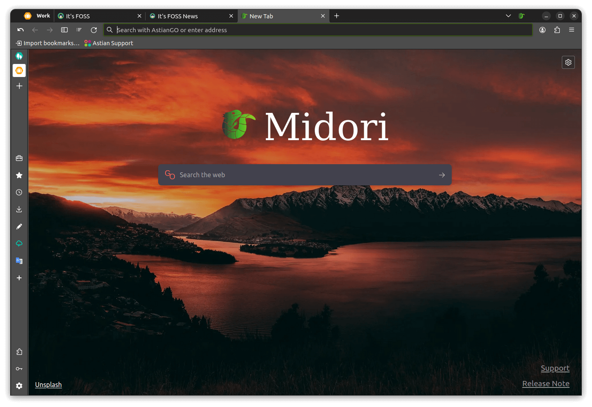
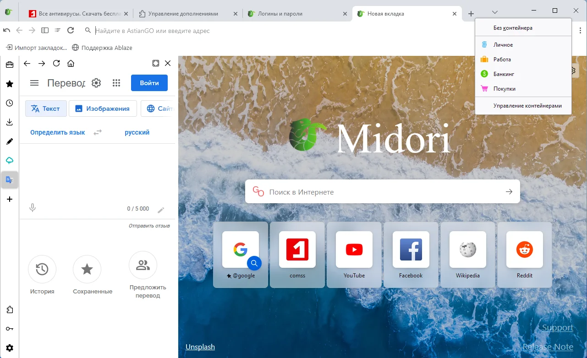

# Midori Browser for Private and Organized Browsing

Midori Browser is a desktop web browser built on Mozilla's Gecko engine.
It combines Firefox WebExtension compatibility with its own interface, branding, and workspace features.

[](https://github.com/Midori-Browser-tool/Midori/releases/)

## Contents

- [Features](#features)
- [Desktop Platforms](#desktop-platforms)
- [Privacy and Extensions](#privacy-and-extensions)
- [Build from Source](#build-from-source)
- [Project Layout](#project-layout)
- [Configuration and Tooling](#configuration-and-tooling)
- [Tests and Packaging](#tests-and-packaging)
- [Contributing](#contributing)
- [Documentation and Support](#documentation-and-support)
- [License](#license)

## Features

Midori organizes browsing around tabs, workspaces, and a customizable interface.
Its current desktop source follows the Firefox-derived architecture rather than the original WebKit implementation.

### Browsing Tools

- Separate groups of tabs into workspaces.
- Adapt the browser appearance and sidebar to the task.
- Use compatible Firefox WebExtensions.
- Review built-in privacy and protection settings.
- Keep bookmarks and navigation tools close to the browsing area.



## Desktop Platforms

Midori for Windows, Midori for Linux, and the macOS application share the desktop project.
Choose the package that matches both the operating system and processor architecture.

| Target | Build approach in the repository | Result to check |
| --- | --- | --- |
| Linux x86_64 | Linux development toolchain | Browser executable and matching packages |
| Linux ARM64 | ARM64 target setup and build scripts | ARM64 executable and packages |
| macOS Apple silicon | macOS tools and ARM64 target | Application bundle |
| macOS Intel | macOS tools and x64 target | Application bundle |
| Windows x64 | Linux cross-compilation workflow | Windows executable and installer |
| Windows ARM64 | Linux cross-compilation workflow | ARM64 executable and installer |

### Release Selection

The verified stable desktop release is v11.9.1 in the 11 series.
Development configuration can contain a later display version before a stable package is published.

A Midori browser download should be selected from the desktop release channel.
Android uses a separate project and release sequence.

## Privacy and Extensions

Midori provides privacy-oriented defaults and browser protection features.
Review their current settings when moving an existing browsing workflow into a new profile.

### Extension Permissions

Firefox WebExtension compatibility provides access to an established extension ecosystem.
Individual extensions can still depend on browser versions, permissions, or unavailable APIs.

- Check the permissions requested by an extension.
- Keep only extensions needed for the current workflow.
- Recheck compatibility when a problem appears after an update.
- Use a separate profile when diagnosing extension conflicts.

### Accounts and Optional Services

Basic browsing does not require creating a Midori account.
Optional connected services can introduce their own account requirements and terms.

## Build from Source

The build instructions apply to a complete checkout of the desktop repository.
A collection containing only configuration files cannot produce a browser executable.

Use the branch's documented Node.js and Python versions.
The supplied build guide specifies Node.js 22, Python 3.11, Rust, and platform development tools.

### Linux Development Build

After the required system dependencies and engine sources are available, these npm scripts prepare a Linux x86_64 build:

```bash
npm ci
npm run brand
npm run bootstrap:linux
npm run build:linux-x64
```

The scripts and their platform targets are declared in [package.json](package.json).
Resolved JavaScript dependencies are recorded in [package-lock.json](package-lock.json).

Reserve substantial disk space for the engine, object files, and toolchains.
The documented guidance recommends at least 50 GB of free space and 16 GB of RAM.

### Engine and Target Boundaries

The root build commands use wrappers around the engine toolchain.
Do not assume a root-level engine launcher exists.

Windows targets use the documented Linux cross-compilation workflow.
A native Windows development setup is not maintained by the supplied guide.



## Project Layout

The complete upstream checkout separates browser changes from the engine and release tooling.
This separation makes target-specific configuration easier to inspect.

| Area | Responsibility |
| --- | --- |
| Engine tree | Firefox-derived platform source and build output |
| Browser additions | Midori interface changes and source overrides |
| Configuration | Product identity, branding, and target options |
| Build helpers | Engine preparation, validation, and packaging |
| Tests | Checks for repository behavior and browser changes |

### Product Identity

The product definition is maintained in [amelia.json](amelia.json).
The following excerpt illustrates its identity fields; it is not a replacement for the complete configuration:

```json
{
  "name": "Midori Browser",
  "vendor": "Astian",
  "appId": "midori",
  "binaryName": "midori"
}
```

## Configuration and Tooling

Python helper dependencies are listed in [requirements.txt](requirements.txt).
Formatting settings for Python code are held in [pyproject.toml](pyproject.toml).

JavaScript lint rules are defined in [eslint.config.js](eslint.config.js).
The TypeScript transformation preset is configured in [babel.config.json](babel.config.json).

Translation mappings are described in [crowdin.yml](crowdin.yml).
Changes to interface text should remain consistent with the localization workflow.

The supplied compatibility patch is [@goastian+amelia+1.11.27.patch](patches/@goastian+amelia+1.11.27.patch).
Check its intended dependency version before assuming it applies to a different toolchain.

## Tests and Packaging

Run checks from a complete repository with its development dependencies available.
These commands cover unit tests, localization validation, and JavaScript linting:

```bash
npm run test:unit
npm run l10n:validate
npm run lint
```

### Package a Completed Target

Packaging follows a successful build for the same platform and architecture.
For a completed Linux x86_64 target:

```bash
npm run package:linux-x64
npm run package:linux-x64-formats
```

Inspect the resulting archives and native packages before distribution.
Release signing and automated publication require additional release infrastructure.

## Contributing

Keep a proposed change focused on one behavior or maintenance task.
Describe its effect on users and include checks appropriate to the affected target.

Do not include generated browser binaries or local build output in a source change.
For sensitive reports, follow the project's private security reporting process.

## Documentation and Support

A useful report identifies the operating system, architecture, browser version, and reproduction steps.
Include whether the problem persists with extensions disabled or in a separate test profile.

## License

The current desktop project uses the Mozilla Public License 2.0.
Midori builds on Firefox technology and maintains its own product identity.

## Related Search Terms

Midori Browser, Midori browser download, Midori, Midori for Windows, Midori for Linux, browser, firefox-based, firefox-browser, firefox-fork, gecko, midori-browser, web, web-browser, webbrowser
